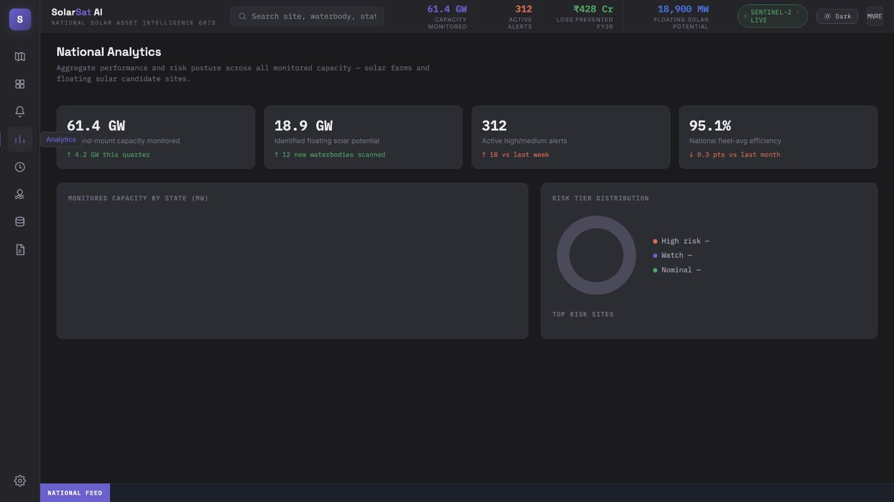
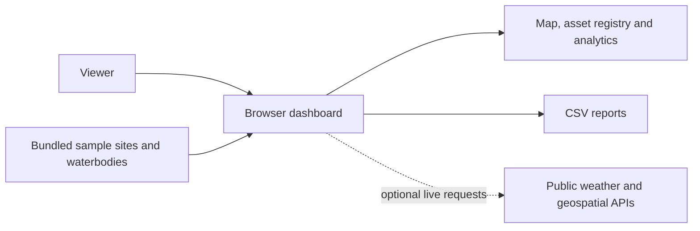

# SolarSat AI
### National Solar Asset Intelligence Grid — with Floating Solar (Waterbody) Detection

A government-grade, satellite-and-GIS-driven monitoring platform for ground-mounted
solar assets and floating-solar (FPV) site feasibility — built entirely on **free
public data**, with **no IoT hardware or proprietary sensors** required.

---

## What's in this package

```
solarsat-ai-project/
├── README.md                              ← you are here
├── LICENSE
├── frontend/
│   └── index.html                         ← the full app (open this in a browser)
├── docs/
│   └── floating-solar-ndwi-methodology.md ← real GEE NDWI/water-permanence pipeline
└── data/
    ├── sites.json                         ← sample solar-park dataset used by the UI
    └── waterbodies.json                   ← sample floating-solar candidate dataset
```

## Quick start

No build step, no dependencies to install. Just open the file:

```
frontend/index.html
```

directly in any modern browser (double-click it, or drag it into a browser tab).
Everything — the maps, charts, and live API calls — runs client-side from that
single HTML file.

> **Note:** if you're viewing this inside a chat/preview sandbox instead of a real
> browser tab, the map basemap tiles and live API calls (see below) will be blocked
> by that sandbox's network policy and the map panel will show a grid pattern
> instead of satellite tiles. Opening the file in a normal browser tab resolves this.

## What's functional right now

- **Command Map** — live Leaflet map of Indian solar parks, AI risk scoring per
  site, actual-vs-predicted output chart, recommendations panel.
- **Asset Registry** — sortable/filterable table, CSV export.
- **Alerts** — filterable national alert feed, CSV export.
- **Analytics** — capacity-by-state chart, risk-tier distribution, top-risk sites.
- **Time Series** — 30-day output trend per site.
- **Floating Solar Detection** — a second map of candidate waterbodies
  (Indira Sagar, Hirakud, Ukai, Nagarjuna Sagar, etc.) scored on water permanence,
  grid proximity, ecological sensitivity, and navigation/irrigation conflict.
- **Reports** — generates and downloads real CSV files (compliance report,
  floating-solar ranking, state digest, alert log).
- **Data Sources** — a live registry of every public dataset the platform is
  designed around, with **working Test buttons** for the keyless/CORS-enabled ones.
- **Dark / Light theme toggle**.

### Real (non-mocked) API calls wired into the frontend

These run directly from your browser — no backend, no API key:

| Source | Used for | Endpoint |
|---|---|---|
| **NASA POWER** | Live 14-day irradiance (GHI) & temperature per solar site | `power.larc.nasa.gov/api/temporal/daily/point` |
| **OpenStreetMap Overpass API** | Real nearby substations for grid-proximity scoring on waterbodies | `overpass-api.de/api/interpreter` |
| **Open-Elevation** | Real elevation lookup for reservoir points | `api.open-elevation.com/api/v1/lookup` |
| **Open-Meteo** | Connectivity test / current weather | `api.open-meteo.com/v1/forecast` |

Everything else (Sentinel-1/2, Landsat, Google Earth Engine, ISRO Bhuvan, SRTM,
ERA5, SoilGrids, etc.) requires authenticated access and/or server-side batch
processing — these are represented in the **Data Sources** page as the pipeline
this platform is architected to ingest from, documented in full in
`docs/floating-solar-ndwi-methodology.md`, but they are not called directly from
the browser in this build.

## Sample data

`data/sites.json` and `data/waterbodies.json` contain the exact records the UI
ships with — useful as a seed/fixture set if you stand up a real PostGIS backend
behind this frontend later.

## Tech stack referenced in the design

Next.js / React, FastAPI, Python, PostGIS, PostgreSQL, Google Earth Engine,
Leaflet/MapLibre, Docker, OpenCV, YOLO, TensorFlow/PyTorch. The current package
ships the frontend layer only, built as a single dependency-free HTML file
(Leaflet via CDN) so it runs anywhere with zero setup; the backend/pipeline layer
is specified in the methodology doc for a future build-out.

## Roadmap (not yet built)

- FastAPI backend + PostGIS database matching the schema described in the
  methodology doc
- Scheduled Google Earth Engine batch jobs (Sentinel-2 NDWI, soiling, fault
  detection models)
- Authentication / role-based access for MNRE, State REDAs, DISCOMs
- RoadSat AI and VanRakshak AI modules (road-distress and forest-encroachment
  detection), specified but not yet built into this codebase

## License

MIT — see `LICENSE`.

## Interface and current data flow



The screenshot shows the locally served frontend and illustrative dashboard metrics. The current project is a frontend prototype; planned satellite processing and backend services are not implemented.


